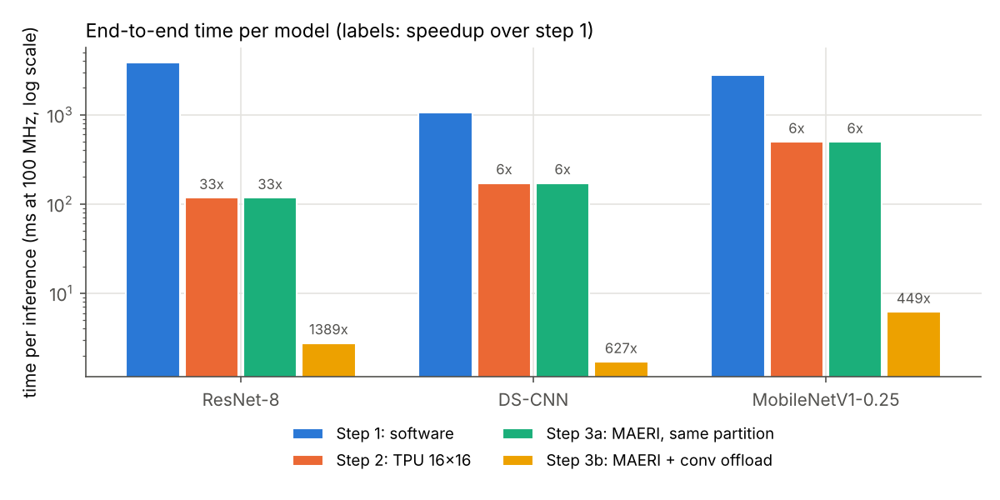
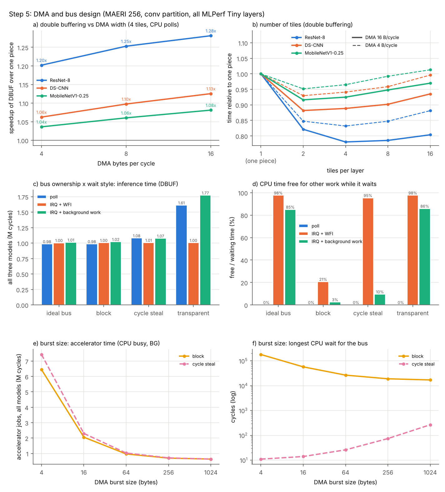
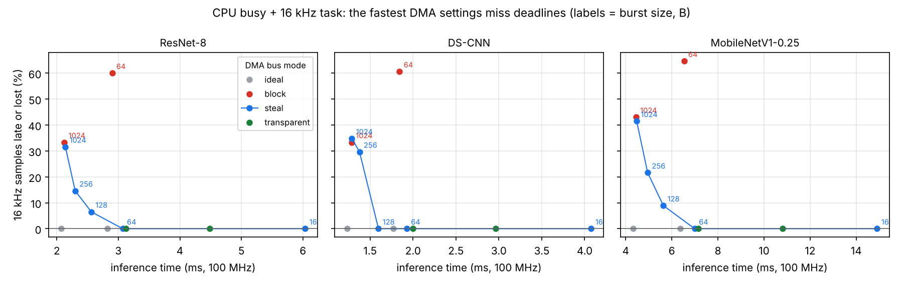
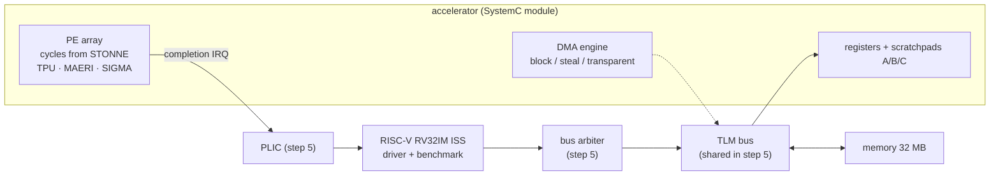

# Where Should the Work Go? HW/SW Partitioning and DMA Design for TinyML on a RISC-V SystemC Platform

An end-to-end SystemC/TLM-2.0 study of how DNN inference time changes as work moves from
a RISC-V CPU to an accelerator, and what the data movement then costs. A memory-mapped
accelerator whose compute timing comes from the [STONNE](https://github.com/stonne-simulator/stonne)
cycle-level simulator is integrated into the [RISC-V VP++](https://github.com/ics-jku/riscv-vp-plusplus)
virtual prototype and runs all 48 INT8 layers of the three [MLPerf Tiny](https://github.com/mlcommons/tiny)
models (ResNet-8, DS-CNN, MobileNetV1-0.25).

COE 407/661 System on Chip term project, KFUPM. Anchor paper: F. Muñoz-Martínez et al.,
"STONNE: Enabling Cycle-Level Microarchitectural Simulation for DNN Inference Accelerators,"
*IEEE Computer Architecture Letters*, 20(2), 2021.

**Start here:** [`docs/Beginner_Guide.pdf`](docs/Beginner_Guide.pdf) (everything from scratch: background, the gap, every file, PhD roadmap) ·
[`docs/Guide.pdf`](docs/Guide.pdf) (setup, every step, how to verify it) ·
[`docs/paper/main.pdf`](docs/paper/main.pdf) (term paper) ·
[`docs/proposal/`](docs/proposal/) (proposal) ·
[`docs/gap/`](docs/gap/) (the research gap and its SystemC proof)

---

## What the project measures

| Step | CPU does | Accelerator does | ResNet-8 | DS-CNN | MobileNet |
|---|---|---|---:|---:|---:|
| S1 software | everything | — | 383.3 M cycles | 106.5 M | 276.8 M |
| S2 16×16 TPU-like mesh | im2col, depthwise layers | GEMMs | 32.8× | 6.2× | 5.6× |
| S3a MAERI, same partition | same as S2 | GEMMs on a flexible fabric | 32.8× | 6.2× | 5.6× |
| S3b MAERI + native conv | only the driver | CONV, depthwise, PW, FC | **1,389×** | **627×** | **449×** |
| S4 design-space exploration | | mesh size, bandwidth, DMA width, sparsity (21 runs) | | | |
| S5 DMA and bus design | sleeps or does other work | + double buffering, interrupt, shared bus | up to 1.28× more | | |
| Gap: real-time task | + a 16 kHz timer task (audio sampling) | S3b accelerator, 43 DMA/bus settings | see [Research gap](#research-gap-dma-settings-vs-cpu-deadlines) | | |

Speedups are over S1, end to end, DMA mode, 100 MHz. S3b takes 2.76, 1.70 and 6.16 ms per inference.



## Main insights

1. **Speeding up a part that is not the bottleneck changes nothing.** MAERI computed 18% faster than the mesh in S3a, and the total changed by 0.1%, because 96–99% of the time was CPU work.
2. **Where the work runs matters more than how fast the engine is.** Native convolution (S3b) made ResNet-8 42× faster than S3a, although its compute cycles went up slightly.
3. **Each improvement moves the bottleneck.** CPU work (S2) → data movement, 76–92% of the time (S3b) → bus sharing and burst overhead (S5).
4. **Once compute is cheap, data movement is the cost.** After S3b, a 4× wider DMA gave 1.54–1.74×; in the gemm partition the same change gave 1.5%.
5. **Overlap only hides what can run in parallel.** With one DMA engine, double buffering hides only the compute: 1.20–1.28× for ResNet-8, 1.04–1.13× for the transfer-bound models.
6. **An interrupt frees the CPU; it does not make the job faster.** Polling is 1.4–2.4% faster on an ideal bus, but on a shared bus polling steals bus time from the DMA (+9.7% vs +2.2% with cycle stealing).
7. **The DMA's bus policy decides who waits.** Block mode freezes the CPU for up to 26,624 cycles, transparent mode slows inference by up to 80%, and cycle stealing bounds each CPU stall to one burst. Going from 64-byte to 1024-byte bursts cuts accelerator time by 35%.



## Research gap: DMA settings vs. CPU deadlines

On a TinyML SoC the CPU keeps time-critical work while the accelerator runs the network: for
keyword spotting (DS-CNN) it must take one audio sample every 62.5 µs. Accelerator and TinyML
studies (STONNE, ZigZag, DORY, MLPerf Tiny) choose DMA settings for inference time alone;
real-time interconnect studies (Restuccia et al., ACM TECS 2019 and IEEE TC 2022; Brilli et al.,
DATE 2022) measure how DMA bursts delay CPU tasks, on FPGA SoCs with generic accelerators. This
project measures the two together: `sw/bench_rt.c` adds a CLINT-timer task (62 µs period,
16-tap FIR, deadline = next release) while all 48 layers run on the step-3b accelerator, and
`scripts/gap_sweep.py` sweeps 43 bus/DMA settings in three scenarios.

- **Ideal bus:** the task never misses (worst response 739 cycles against a 6,200-cycle deadline): the problem is invisible without bus contention.
- **Block-mode DMA:** 17–93% of samples late or lost at every burst size.
- **Same inference time, different deadlines:** at 1024-B bursts, block, steal and transparent DMA finish within 1.2% of each other, but block misses 41–46% of samples, steal 34–46% and transparent 0%.
- **The right setting depends on the CPU's workload:** with the CPU asleep between samples, transparent DMA meets every deadline at ≤ 1% cost; with the CPU busy, transparent DMA is 47–61% slower and the best on-time setting is cycle stealing with 64–128 B bursts, at +24% to +57% inference time.



## Course project: request/grant bus (week 1)

The final course project (plan: `docs/plan/Final_Project_Plan_v3.docx`) asks where shared-bus
arbitration fails to protect a streaming sensor and a CPU deadline while the DNN accelerator runs.
Week 1 adds the bus model it needs, next to the step-5 model (which stays unchanged, so every
earlier result is still reproducible):

- `accel/rg_bus.h`: one bus, a request/grant arbiter and three masters (CPU, sensor DMA, DNN DMA).
  The bus is granted only when it is free; one outstanding request per master; tenures cannot be
  interrupted; a handover of `a` cycles (default 1) is charged only when ownership changes.
  Policy variants: `rr`, `sensor-first`, `cpu-first`, `buffer` (simplified, inspired by Roh et al.)
  and `budget` (fragments + bytes per aligned window, simplified, inspired by AXI-REALM).
- The CPU port synchronises the core's local time before every access and performs the access only
  after the grant. The accelerator requests the bus for every DMA burst (or budget fragment).
  This is exact but slow for CPU-heavy code; `--bus-fast-path` lets an uncontested CPU skip the
  synchronisation (same arbitration, but interrupts may be taken a few cycles differently), so it is
  used only for interrupt-free CPU-only checks.
- Platform option: `accel32-vp --bus-arbiter rr|sensor-first|cpu-first|buffer|budget
  [--bus-handover N] [--bus-frag-bytes B --bus-window-cycles W --bus-budget-bytes X]`.
  The log ends with `RGBUS,...` lines (grants, busy, wait, max wait per master, in cycles).
- Tests (`cd unit_test && make test_rg`):
  - `tb_rg`, plan tests 1-7 with stub masters: policy order, sensor-first wait <= beta + a,
    round-robin grant counts and busy shares, starvation, budget per aligned window, handover only
    on ownership change, accounting.
  - `tb_dma_rg`, plan test 8: with the CPU asleep, the part-1 cycle counts of `tb_dma` equal the
    step-5 reference exactly with `a = 0`, and are exactly +1 cycle per job with `a = 1` (the one
    ownership change after the CPU's START write).
  - On the platform, a CPU-only run (`bench_sw.elf --bus-arbiter rr --bus-fast-path`) reproduces
    `reference_results/step1_sw.csv` exactly (48/48 rows), and the step-5 model is unchanged
    (`step5c_bus_steal_bg.csv` identical).

## Course project: stage A (week 2)

`accel/sensor_dma.h` adds the streaming sensor (FIFO + DMA, third bus master), `sw/bench_kws.c` runs one
DS-CNN inference from a release with the 62 us control task and the sensor active, and
`scripts/stageA.py` sweeps 4 policies x 2 burst lengths x 5 sensor rates x 3 FIFO depths (124 runs, ~4 min).
Results and their reading: `docs/plan/STAGE_A_RESULTS.md`, figure `reference_results/figures/fig6_stageA.png`.

## Course project: stage B

`scripts/stageB.py` sweeps the sensor threshold, finds the exact minimum FIFO depth for 240 (policy, burst,
rate, threshold) points by bisection (912 runs), adds 256-B bursts and the budget + fragmentation policy, and
applies the research-gap test of the plan. Main result: the four arbitration policies give minimum FIFO depths
within one sample of each other; the DNN burst length, the sensor threshold and the per-burst overhead decide the
outcome. Details: `docs/plan/STAGE_B_RESULTS.md`; figures `fig7_stageB_minfifo.png`, `fig8_stageB_tradeoff.png`.

## The simulated SoC



- **CPU:** VP++ `tiny32` timing at 100 MHz. Every fetch, load and store goes through the bus to a 1-cycle memory.
- **Accelerator** (`accel/stonne_accel.h`): an `sc_module` with a TLM-2.0 target (registers and scratchpads) and a TLM-2.0 initiator (DMA). It runs `OP_GEMM` on every fabric and `OP_CONV` (standard and depthwise) on MAERI. Each DMA burst costs `10 + bytes/4` cycles.
- **The same accelerator source** compiles against SystemC 2.3.3 (unit tests) and SystemC 3.0 (inside VP++).
- **Step 5 additions:**
  - tiling with ping-pong buffers and a separate PE thread (double buffering);
  - a completion interrupt through an FE310-style PLIC, with a trap handler and race-free `WFI`;
  - a shared-bus model (`accel/shared_bus.h`) with the burst/block, cycle-stealing and transparent DMA modes.

## Repository layout

| Folder | Contents |
|---|---|
| `accel/` | accelerator model, STONNE backend, register map, step-5 shared-bus model, project request/grant bus (`rg_bus.h`) |
| `vp_platform/accel/` | the `accel32-vp` platform for RISC-V VP++ (CPU, bus, memory, accelerator, PLIC) |
| `sw/` | bare-metal C: kernels, drivers, interrupt handler, benchmarks (`bench_rt.c`: gap experiment), MLPerf Tiny layer table |
| `unit_test/` | `tb_accel` (step A), `tb_dma` (step 5), `tb_rg` / `tb_dma_rg` (project bus tests): on SystemC 2.3.3 |
| `scripts/` | one script per step, run helper, summaries, sweeps (`dse.py`, `dse5.py`), plots |
| `setup/` | install, download (pinned commits), build STONNE, build the platform, shell setup |
| `workloads/` | MLPerf Tiny layer extraction and the extracted layer table |
| `patches/` | two small STONNE patches: expose the cycle count; initialise `MSwitch` link pointers (bug fix) |
| `reference_results/` | every CSV, log and figure of the tested run |
| `docs/` | `Beginner_Guide.pdf`, `Guide.pdf`, `paper/` (LaTeX, IEEE format), `proposal/` (LaTeX, .docx, .pdf), `summary/`, `gap/` (research-gap argument) |

## Quick start

Requirements: Docker with an Ubuntu 24.04 image and SystemC 2.3.3 in `/opt/systemc` (the
COE 407 `systemc-env` image). No hardware board is needed.

```bash
cd /workspace/soc-accel-project
bash setup/01_install_packages.sh       # compilers, Boost, RISC-V GCC, Python
bash setup/02_get_sources.sh            # STONNE, RISC-V VP++, MLPerf Tiny at tested commits
bash setup/03_build_stonne.sh
bash setup/04_build_vp.sh               # builds accel32-vp
source setup/env.sh

(cd unit_test && make && make test && make test5)   # accelerator alone: ALL TESTS PASSED
bash scripts/step0_reproduce_stonne.sh               # S0: STONNE alone
bash scripts/step1_software.sh                       # S1
bash scripts/step2_simple_accel.sh                   # S2
bash scripts/step3_better_accel.sh                   # S3a, S3b
python3 scripts/dse.py && python3 scripts/plot_results.py      # S4
bash scripts/step5_dma_extension.sh                  # S5: checked runs, sweeps, figure
python3 scripts/gap_sweep.py && python3 scripts/gap_analyze.py --plot   # research gap (43 runs)
bash scripts/regress_all.sh                          # rerun everything, compare with reference_results/
```

Always run scripts with `bash script.sh`, because a Windows-mounted folder drops the execute bit.

## Verification and reproducibility

- **Correct results:** every accelerated layer output is compared with the CPU result. Each checked run reports `144 rows, 0 FAIL`.
- **Unit tests:** the accelerator is tested alone on GEMM and CONV jobs, refused jobs, double-buffering timing bounds, interrupts and the three bus modes.
- **Step 5 changes nothing earlier:** step 5a checks that its one-piece DMA rows equal step 3b layer by layer (`48/48 -> IDENTICAL`).
- **Deterministic:** the data are fixed pseudo-random values. Compare your run with `reference_results/`, for example `diff results/step2_tpu.csv reference_results/step2_tpu.csv`; the cycle counts must match exactly.
- **Tested commits:** STONNE `22634b8`, RISC-V VP++ `9156184`, MLPerf Tiny `4addd0f`.
- **STONNE fix:** STONNE's `MSwitch` constructor left its link pointers uninitialised, and the last multiplier switch never gets a forwarding link. Depending on heap layout, a run could abort with `Assertion pck->get_data_type()==IACTIVATION failed`. `patches/stonne-mswitch-init.patch` initialises them; `scripts/regress_all.sh` confirms that every earlier result is unchanged.
- **Timer:** the platform uses VP++'s simulation-time CLINT (mtime in µs of simulated time), so timer interrupts are deterministic.

## Rebuilding the paper

```bash
python3 docs/paper/make_figures.py results docs/paper/figures
python3 docs/paper/make_tables.py  results docs/paper/tables
cd docs/paper && latexmk -pdf main.tex      # or upload docs/paper to Overleaf (pdfLaTeX)
```

## Limits of the model

- **Slow CPU:** the software baseline is plain C on a slow, cacheless core, so absolute speedups over S1 are large. Compare the designs with each other.
- **Simple DMA and bus:** DMA timing is analytical, and the shared bus has no split transactions.
- **Compute timing only:** compute cycles come from STONNE's model, so there are no area or power claims.
- **Layers, not whole inferences:** layers run on fresh random data, and pooling and requantization are not modeled.

## Licence and credits

- **Code written for this project:** free to use.
- **`vp_platform/accel/main.cpp`:** derived from RISC-V VP++ (MIT License, University of Bremen and Johannes Kepler University Linz).
- **Downloaded by the setup scripts, not included:** STONNE (MIT), RISC-V VP++ (MIT) and MLPerf Tiny (Apache-2.0), each under its own licence.

Author: Abdelrahman Youssef, KFUPM.
